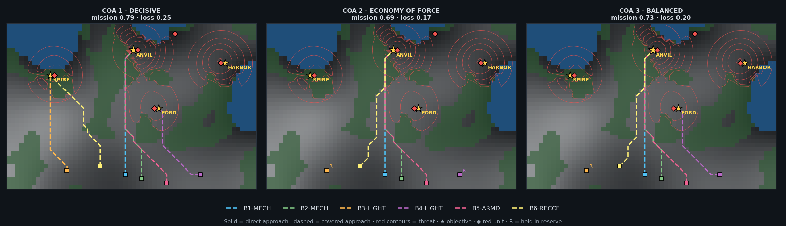
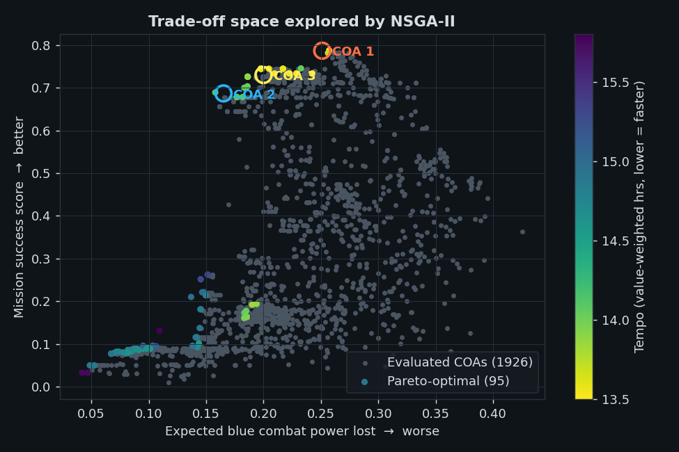
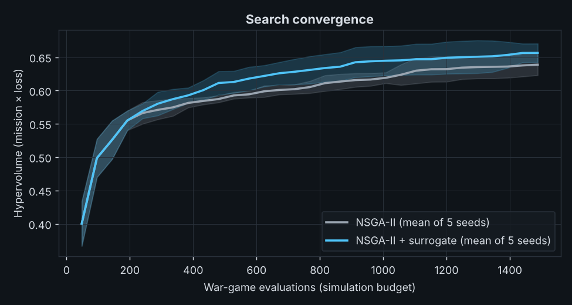

# COA-Forge

**Automated Course of Action (COA) generation and Monte Carlo war-gaming.**

[](https://github.com/snehaislamm/coa-forge/actions/workflows/ci.yml)


COA-Forge takes a planning scenario (terrain, friendly and opposing forces, objectives) and does three things:

1. **Generates** thousands of candidate COAs: which unit seizes which objective, by which approach, at what H-hour.
2. **War-games** each one against a reactive opposing force in a stochastic simulator.
3. **Writes a decision brief**: three distinct, Pareto-optimal COAs with a comparison matrix, confidence intervals, a red-intelligence stress test, and a synchronization matrix for each.

On the bundled scenario, the full run takes about **20 seconds on a laptop** and war-games about **2,000 COAs**.

> The scenario is entirely fictional and abstract. Units have notional combat-power numbers, not real equipment data. The project demonstrates the decision-support *pipeline* (search, simulation, ML and reporting), not a validated combat model.



---

## Why this problem

In the planning process, staffs usually develop only 2–3 COAs by hand, under time pressure, and war-game them on a whiteboard. That limits how much of the option space anyone ever looks at. COA-Forge explores the space automatically and gives the planner a short list that is:

- **Non-dominated.** No other COA it found is better on mission success, losses *and* tempo at once.
- **Distinct.** Each COA represents a different trade-off (decisive, economy of force, balanced), not three variations of the same plan.
- **Quantified.** Every number comes with a 95% confidence interval from 2,000 fresh Monte Carlo replications.
- **Stress-tested.** Each COA is re-run against a red force that reads blue's intent poorly, as expected, or almost perfectly.

## How it works

```
scenario.yaml ─► Terrain + threat map ─► Threat-aware A* routes (direct / covered)
                                               │
              ┌────────────────────────────────┘
              ▼
  NSGA-II genetic search  ◄──── ML surrogate pre-screen (random forest)
     │        ▲                        ▲
     ▼        │                        │ retrained on every war-game result
  Monte Carlo war-game (vectorised numpy, 64 runs per COA)
     │
     ▼
  Local-search polish ─► Pick 3 distinct Pareto COAs ─► Re-adjudicate (2,000 runs)
                                                       ─► Red-intel stress test
                                                       ─► brief.md + figures
```

| Module | What it does |
|---|---|
| `scenario.py` | Procedural terrain (elevation, forest cover, impassable water), forces and objectives from YAML. Builds a red **threat influence map**. |
| `pathing.py` | **A\*** on an 8-connected grid. Edge cost = terrain × (1 + w·threat): w = 0 gives the fastest route, a larger w gives a covered approach. Results are cached. |
| `simulator.py` | **Stochastic adjudicator** that runs all Monte Carlo replications at once as numpy arrays (~5 ms per COA). Models movement uncertainty, attrition on the approach, time-stepped **Lanchester square-law** close combat, break points, a defender advantage, and a **reactive red reserve** that commits to the objective with the most value at risk. |
| `optimizer.py` | **NSGA-II** from scratch: fast non-dominated sort, crowding distance, tournament selection, 2-D hypervolume tracking. Adds a **memetic local search** with coordinated two-unit moves to find plans that single mutations miss. |
| `surrogate.py` | **Random-forest surrogate** trained on 30 engineered features (force ratios, arrival timing and spread, route exposure, and so on). Pre-screens 6× more candidates than the simulator can afford. Half of each batch is exploited from the surrogate and half is explored at random. Its feature importances double as a **sensitivity analysis**. |
| `brief.py` | COA selection, high-fidelity re-evaluation, weighted decision matrix, and per-COA synchronization matrix. |
| `viz.py` | Maps with routes and threat contours, Pareto front, convergence, and per-objective outcome plots. |

## Results (bundled scenario: *Exercise NORTHERN BASTION*)

Full output: **[results/brief.md](results/brief.md)**

| | COA 1: Decisive | COA 2: Economy of force | COA 3: Balanced |
|---|---|---|---|
| Mission success score | **0.78** | 0.66 | 0.73 |
| P(critical objective held) | 94% | 94% | 98% |
| Blue combat power lost | 0.26 | **0.16** | 0.20 |
| Weighted score | **0.70** | 0.30 | 0.63 |

**What the tool discovered on its own:** massing three units on the critical airstrip matters most. Feature importance ranks force ratio and firepower at that objective as the top two drivers. Spare units add value only when they are paired: one light unit sent alone to the relay site usually loses, but two units together hold it about 80% of the time. That coordinated move is exactly what the local-search step was built to find.



### Does the ML surrogate actually help?

I benchmarked it against plain NSGA-II over 5 seeds at equal simulation budgets (`benchmarks/surrogate_benchmark.py`):

| Method | HV @ 528 evals | HV @ 1008 evals | HV @ 1488 evals | Best mission score |
|---|---|---|---|---|
| NSGA-II | 0.593 ± 0.005 | 0.619 ± 0.008 | 0.639 ± 0.016 | 0.753 ± 0.024 |
| NSGA-II + surrogate | **0.613 ± 0.016** | **0.645 ± 0.022** | **0.656 ± 0.014** | **0.782 ± 0.010** |

The surrogate reaches higher hypervolume at every budget and finds better, more consistent top COAs. Its hold-out R² is 0.97 for mission success and 0.92 for losses. My first version let the surrogate pick the *whole* batch, and it did *worse* than the baseline because the search kept chasing the model's own biases. Splitting each batch into exploit and explore halves fixed that.



## Quick start

```bash
git clone https://github.com/snehaislamm/coa-forge.git && cd coa-forge
pip install -e ".[dev]"

python -m coaforge scenarios/northern_bastion.yaml --out results -v   # ~20 s
python -m unittest discover -s tests                                   # 18 tests
python benchmarks/surrogate_benchmark.py                               # ~2 min
```

Or with Docker:

```bash
docker build -t coaforge . && docker run --rm -v "$PWD/results:/app/results" coaforge
```

CLI options: `--generations`, `--pop`, `--runs` (Monte Carlo runs per evaluation), `--final-runs`, `--seed`, `--no-surrogate`.

### Write your own scenario

```yaml
objectives:
  - {id: OBJ_ANVIL, name: "Airstrip", pos: [6, 30], value: 4, critical: true}
blue:
  - {id: B1-MECH, pos: [36, 28], strength: 100, firepower: 1.2, speed: 7.0}
red:
  defenders: [{id: R1, pos: [6, 31], strength: 70, firepower: 1.1}]
  reserve:   [{id: R-RES, pos: [2, 40], strength: 75, firepower: 1.2, speed: 6.0}]
params: {t_max: 16.0, p_detect: 0.6, reserve_reaction: 4.0}
```

All model parameters (attrition rates, break points, defender advantage, uncertainty) are listed in `simulator.DEFAULTS` and can be overridden per scenario.

## Engineering notes

- **Common random numbers** during search, so COAs are compared on the same dice rolls. **Fresh random numbers** for the final brief, so the optimizer's luck doesn't carry into the reported figures.
- **Vectorised simulation.** Replications run as array dimensions, not Python loops, so a COA is adjudicated in milliseconds.
- **CI.** GitHub Actions runs ruff, the unit tests on Python 3.10–3.12, and a small end-to-end smoke run.
- **Tests** cover A\* correctness (detours, unreachable goals, the cover/time trade-off), simulator invariants (determinism, metric bounds, concentration of force), NSGA-II primitives (sorting, crowding, hypervolume) and an optimizer integration test.

## Limitations and next steps

- The combat model is deliberately simple (aggregate Lanchester attrition, no fires, logistics or ISR). The architecture keeps adjudication behind one `evaluate()` call, so a higher-fidelity simulator could be dropped in.
- Red's behaviour is a single reactive rule. **Next:** co-evolve red COAs to find blue plans that are robust to a *best-responding* adversary (a minimax war-game).
- **Next:** parallelise evaluation with Dask or Ray, tune hyperparameters with Optuna, add a Streamlit front end for interactive what-if analysis, and have an LLM draft orders text from the synchronization matrix.

## License

MIT. Built by Sneha Islam (Nanotechnology Engineering, University of Waterloo) as a proof-of-concept for applied AI in defence decision support.
